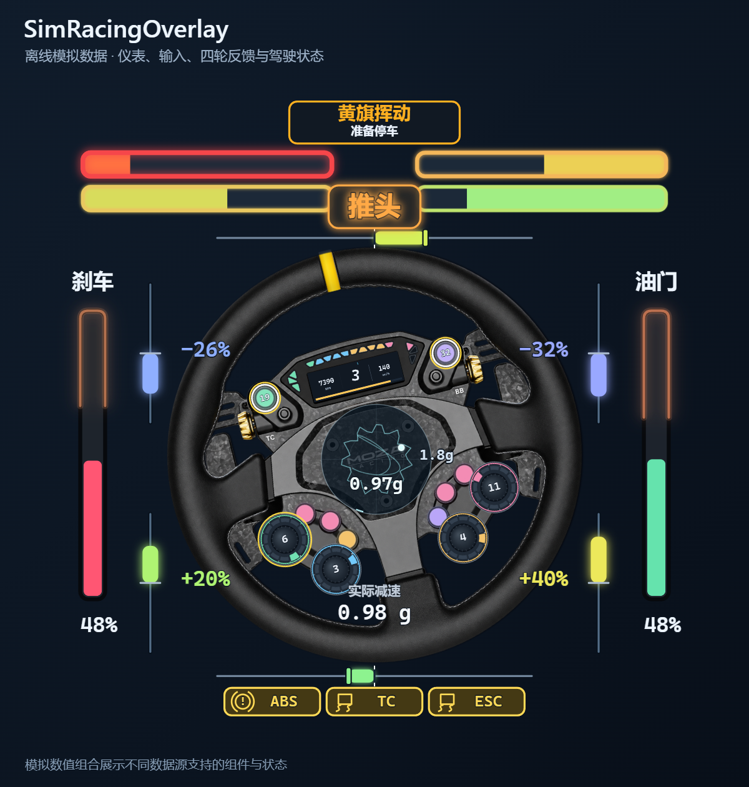
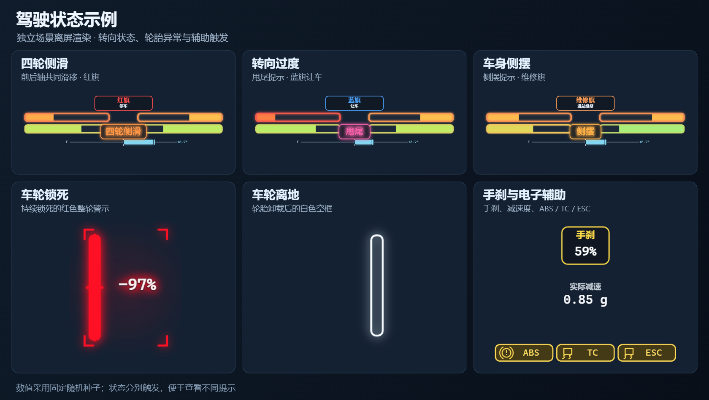

# SimRacingOverlay

赛车遥测透明叠加层：可显示在桌面上，也可作为 OBS 浏览器源使用。包括输入可视化、逐轮滑移与余量趋势、转向状态、踏板提示和 G 力球。每个控件可独立移动、缩放、旋转、显隐、锁定、调透明度和调整层级，支持多选和整体复位。默认包含轮盘图片与仪表外观，整组相对屏幕居中靠下。

当前源码版本为 **1.7.1**，组件页覆盖18个现有HUD组件，并提供当前配置与草稿的实时动态比较、独立的配色与显示辅助。发行版本源码以已发布的 GitHub tag 为准，下载见 Releases 实际附件；构建方法见 [构建说明](docs/BUILD.md)，改动见 [版本记录](CHANGELOG.md)。

## 界面预览

以下图片由实际界面**离屏渲染**生成，使用固定随机种子的模拟数值，展示随包提供的仪表样式、控件和驾驶提示。不同游戏支持的数据不同，图中组合展示各类能力；互斥状态分别呈现。

### 完整仪表与输入反馈

### 驾驶状态

总览展示推头；下图补充四轮侧滑、甩尾、侧摆、车轮锁死、离地、手刹及 ABS / TC / ESC 提示。

### 旗语与行动提示

## 下载与开始

1. 从 [Releases](https://github.com/Cormor/SimRacingOverlay/releases) 下载已发布版本的 **SimRacingOverlay-版本号-Setup.exe**，双击并按界面完成安装。默认安装到文档目录的 `AI/Apps/SimRacingOverlay`，也可以选择其他可写目录；运行环境已包含，无需 Python、Node.js 或开发工具。
2. 从开始菜单打开 **SimRacingOverlay**，直接进入管理窗口；启动时没有常驻命令窗口。托盘可打开管理页、隐藏画面、编辑布局和退出程序。
3. 按 **Ctrl+Alt+M** 进入或完成布局编辑。方向盘、踏板及按钮设置在管理窗口中调整；设备映射保存在本机，不随共享预设分发。
4. iRacing SDK 和 ACR 原生共享内存会自动读取；F1 25 的 UDP 设置见下方接入说明。没有游戏遥测时，仍可显示设备输入并编辑布局。

安装程序完全离线，保留已有配置、布局和下载盘面，不自动修改 OBS、SimHub 或新增开机启动。OBS 与桌面可独立显示；隐藏桌面时，OBS 的源仍可工作。安装与复建方法见 [Windows 安装说明](docs/INSTALL.md)。

Windows 安装版使用离线 Setup，发行版本源码以已发布的 GitHub tag 为准。公开下载以 [Releases](https://github.com/Cormor/SimRacingOverlay/releases) 的实际附件为准；旧版 Windows ZIP 使用其随包说明，GitHub 自动生成的 Source code 压缩包不包含运行环境。

## 支持开发

管理窗口侧栏的 **支持开发** 可查看支付宝 ¥5.98 收款码与微信赞赏码（建议 ¥6），自愿支持。收款码随应用离线提供，付款使用手机完成。见 [支持开发](docs/SUPPORT-DEVELOPMENT.md)。

## 管理窗口与退出

管理窗口按调整对象分组：

- **概览**：查看当前布局、游戏数据与设备状态，开启或隐藏HUD。
- **布局编辑**：拖动和调整18个组件，修改自动保存；撤销、重做和完成编辑常驻。
- **组件样式**：同输入对比已应用效果与修改预览，调整显示效果、配色和辅助。只有点击“应用到…”才提交当前组件；其它组件草稿可从目录继续调整。
- **方向盘**：选择已安装盘面会立即切换；未安装盘面先下载再使用，仪表与按键映射在同页调整。
- **设备输入**：查看真实输入并学习轴绑定。已保存绑定和待保存修改分开显示；采用后还需保存设备设置，取消采样保留原绑定。
- **显示与连接**：选择显示器、查看接入方式及复制OBS地址。版本检查和本地扩展包位于“版本与更新”。

单击托盘图标打开管理窗口，右键打开操作菜单。管理窗使用普通窗口层级，编辑时也不强制置顶。Ctrl+Alt+M 进入或完成布局编辑，组合键可在连接设置中修改。正常现场编辑可以直接拖动屏幕上的 HUD；管理面板按布局避让，拖动时暂时隐藏，空间不足时使用全屏编辑。Esc 返回管理器。布局编辑期间最小化时完成并保存编辑，保留桌面叠加显示；恢复窗口回到概览。其他页面最小化保留原页面与叠加层显隐设置。保存未完成时保留编辑并提示原因。

选择托盘的 **退出叠加程序** 会先处理当前编辑的保存，再关闭桌面及本安装的采集服务，并暂停由 SimHub / OBS 触发的自动拉起。保存被拒绝或失败时保留编辑。从开始菜单手动启动会解除暂停；仅关闭管理窗口会保留后台叠加程序。

## 布局编辑

按 **Ctrl+Alt+M** 进入编辑。单击选择，Shift / Ctrl 加选，空白处拖框多选；拖动选区、方向键微调，右下角等比缩放，角度框旋转。每个模块可独立显隐和锁定。

“移动整体”选中全部启用模块后直接拖动画布；“整体复位”恢复共享的屏幕中下方默认布局，“移回屏内”找回越界选区。支持 Ctrl+Z / Ctrl+Shift+Z 撤销与重做、对齐、布局 JSON 导入导出。修改自动保存，保存成功后退出编辑。

编辑器还可选择方向盘盘面：默认内置原款，SIMAGIC GT Pro 圆盘可从 GitHub 下载后离线使用。按键映射按盘面保存，无屏盘面可搭配独立仪表。操作与扩展方法见 [方向盘盘面](docs/WHEEL-FACES.md)。

管理窗口和直接编辑的设计见 [UI 设计](docs/UI-DESIGN.md)，组件见 [UI 组件](docs/UI-COMPONENTS.md)，设计源见 [设计源说明](design/README.md)；原编辑规范见 [UE 与 UI 规范](docs/UE-UI.md)，算法版本与回放对照见 [算法基线](docs/ALGORITHM-BASELINE.md)。

## 组件算法与表现

管理窗的“组件与动画”页列出全部18个现有HUD组件，分别展示功能算法、显示样式、动画、配色和显示辅助；固定能力也保留名称与说明。油门与刹车的轮胎响应提示可切换算法和表现，原始踏板填充继续直接显示设备输入。其他组件沿用各自的现有算法，配色作用于真实组件内容。内置动画采用即时更新；扩展包可提供表达状态或变化的动画。

当前已应用与正在调整的草稿并排动态显示，使用相同输入和时间。所选组件立即显示有效的内置演示，并在短周期内持续变化；可播放、暂停和从头演示，暂停后切换组件或选项仍立即显示内容。没有遥测时使用明确标识的内置演示输入，演示不会写入遥测或运行配置。每个组件可选择标准、Protan、Deutan、Tritan或高对比配色；配色只改变颜色，保留当前分段、虚线、边框和文字。显示辅助单独选择标准、色弱辅助或高对比，沿原组件的位置补充读数与标记，保留原有形状和显示条件。旧配置和草稿保留原有四项选择，新增显示辅助默认标准。

应用前检查能力组合，成功后保存当前组件选择并刷新 HUD；其他组件的草稿保留。随包的 `examples/pedal-motion.component.json` 可直接导入，`examples/component-package/` 提供可编辑源码。代码扩展需要可信来源，盘面仍使用不执行代码的数据包。契约与扩展方法见 [组件插件](docs/COMPONENT-PLUGINS.md)，交互方法见 [组件体验](docs/COMPONENT-EXPERIENCE.md)，配色依据与范围见 [组件无障碍配色](docs/COMPONENT-ACCESSIBILITY.md)。

## 支持范围

| 数据 / 设备 | 行为与限制 |
| --- | --- |
| ACR（Assetto Corsa Rally） | 从共享内存读取逐轮物理数据，支持本项目的轮胎与转向趋势显示。 |
| F1 25 | 可接收 2025 格式的原生 UDP，读取逐轮滑移率、侧滑角、轮胎力和载荷。需要按下文配置 SimHub UDP 转发；辅助开启设置不等于 ABS / TC 正在触发。 |
| iRacing | 直接只读接入本机 SDK 共享内存，读取基础仪表、踏板、车身运动和有效的 ABS 触发字段。缺少逐轮物理量时，用有效车身运动与转向输入估计裕度；原前后轴侧滑条可显示估计侧偏角。旗语及中文解释仅接受有效 SDK 数据。 |
| SimHub 支持的其他游戏 | 本插件导出标准化数据。速度、挡位、转速、踏板和 G 力等以游戏实际提供为准；不提供的逐轮物理量不会被伪造，部分辅助不显示。 |
| DirectInput 方向盘、踏板、手刹 | 自动枚举，支持不同品牌和多个独立设备；学习轴行程 / 反向。仅测试了本地设备与模拟映射，不能保证所有驱动和设备。 |
| 按钮 | 盘面分别定义实体位置；可录入或手动设置各位置的按钮编号，按盘面保存。 |
| MOZA 灯色 | 可选只读观察器读取 Pit House / SimHub 已发送的已识别灯光协议；不是硬件灯光执行回执，也不修改方向盘灯光设置。其他型号回退到软件灯效。 |
| 方向盘仪表屏 | 按盘面屏幕能力显示；无屏盘面可选择独立仪表。统一字号与语义色，使用系统字体回退。 |

横向状态按四轮分别显示：左右各两根长条，上条对应前轮、下条对应后轮，同侧向画面中间填充。填充与整条颜色反映当前侧滑程度，边框加入最近 100 ms 的趋势和有支持的轮胎力响应；轮胎卸载时整条清空并显示白色辉光。纵向风险收在油门 / 刹车边框，不再单独绘制纵向条。两组横向条默认放大 2 倍，可在编辑模式调整，已有保存的大小与位置保留。

缺少某轮滑移角时，有效车身局部速度可支持降级观察；取得逐轮角度后，对应轮位优先使用独立观测。缺少足够运动数据、暂停或断流时，对应读数停止显示。

绘制跟随浏览器刷新节奏，按组件检测变化并局部重绘；未变化区域保留，重叠组件按原层级处理。静态轮盘、灯带路径和未变化的仪表内容可复用。遥测优先使用持久事件流推送，多个查看端共享采集；断线时自动使用 HTTP 并恢复事件流。遥测处理与绘制分开，重复帧跳过重复整理。计算会话从首个样本固定处理拥有者；Worker 机制故障后在下一新样本建立主线程模型，不重放失败帧或恢复旧模型。适配和性能验证范围见 [iRacing 与性能验证记录](docs/IRACING-PERFORMANCE.md)。

余量和推头 / 甩尾提示是基于遥测的状态趋势，不是实测摩擦系数或保证安全的抓地极限。不同游戏暴露的数据不同，不能把 ACR 的完整能力理解为所有游戏都支持。

## F1 25 的 UDP 接入

游戏继续将遥测发送到 SimHub 原有的端口。在 SimHub 的 F1 25 游戏设置中，增加 UDP 转发目的地 **127.0.0.1:20778**；游戏的输出格式选择 **2025**，发送频率建议 **60 Hz**。不要把游戏的发送端口直接改成 20778，否则 SimHub 可能收不到数据；已有其他转发目的地也应保留。

有效 UDP 优先使用，其次是有效共享内存，两者都不可用时才使用 SimHub 备用数据。UDP 中暂缺某类包时，仅对应字段缺失，不拿较慢的 HTTP 数据补入动态状态。配置说明和字段约定见 [遥测接入说明](TELEMETRY.md)。

## 更新与卸载

管理窗的“版本与更新”页可检查正式 GitHub Release；发现更新时托盘右上角显示标记，后台检查不弹窗，也不自动安装。用户可下载 hotfix、导入本地盘面/算法/组件包，或下载完整更新后打开 Setup 安装并重启。盘面支持新 ID 与已有 ID 的本地替换。

完整更新沿用原安装目录，先保存编辑并正常退出，再替换程序文件。设置、校准、布局、盘面、桌面配置和本地组件选择保留；传统算法活动选择回到新完整版本的内置基线，导入文件保留。组件 API 或组合不兼容会给出明确错误。旧 Release 缺少直接安装元数据时仍可打开发布页。协议和包作者入口见 [更新与本地模块](docs/UPDATES.md)。

在 Windows“已安装的应用”中选择 **SimRacingOverlay → 卸载**。卸载移除程序文件、开始菜单入口及属于本安装的自启动项，保留用户数据，日后可以在原目录重新安装。既有 OBS / SimHub 集成由其原有集成入口管理。

日常启停使用开始菜单与托盘的“退出叠加程序”，退出会暂停自动拉起；再次从开始菜单打开可恢复。它不会关闭 SimHub / OBS / Pit House。

## 隐私

不含作者的设备配置、用户路径、录像、日志、OBS 场景或原始 Git 历史。运行状态写本机安装目录的 `runtime`；设置与布局写 `settings.json` 和 `assets/layout.json`，导入的盘面、算法与组件及其选择写 `assets/wheel-packs`、`assets/modules` 和 `assets/components`；输入服务仅绑定 `127.0.0.1`，不提供局域网服务。不向项目作者上传遥测。分享问题时不要直接打包整个安装目录；其中可能包含你自己的设备名称、设备标识、路径和遥测。

## 源码构建

见 [构建说明](docs/BUILD.md)。完整源码随对应 GitHub tag 提供；第三方组件按各自许可证分发，见 [THIRD_PARTY_NOTICES.md](THIRD_PARTY_NOTICES.md)。

## 许可

使用与 AudioSubtitleOverlay 相同的 **Non-Commercial Source-Available License 1.0**，个人非商业使用允许，商业使用须获得授权。这是公开源码的非商业许可证，**不是 OSI 开源许可证**。详见 [LICENSE](LICENSE) 和 [COMMERCIAL-LICENSE.md](COMMERCIAL-LICENSE.md)。

## 共享预设与隐私

默认仪表外观、颜色、控件尺寸和相对位置是公开预设，记录在 `layout-preset.js`。共享预设不包含显示器 ID、个人设备实例 ID、账号、密码或访问令牌。实际设备映射、运行状态和登录凭据不会打入安装包。
