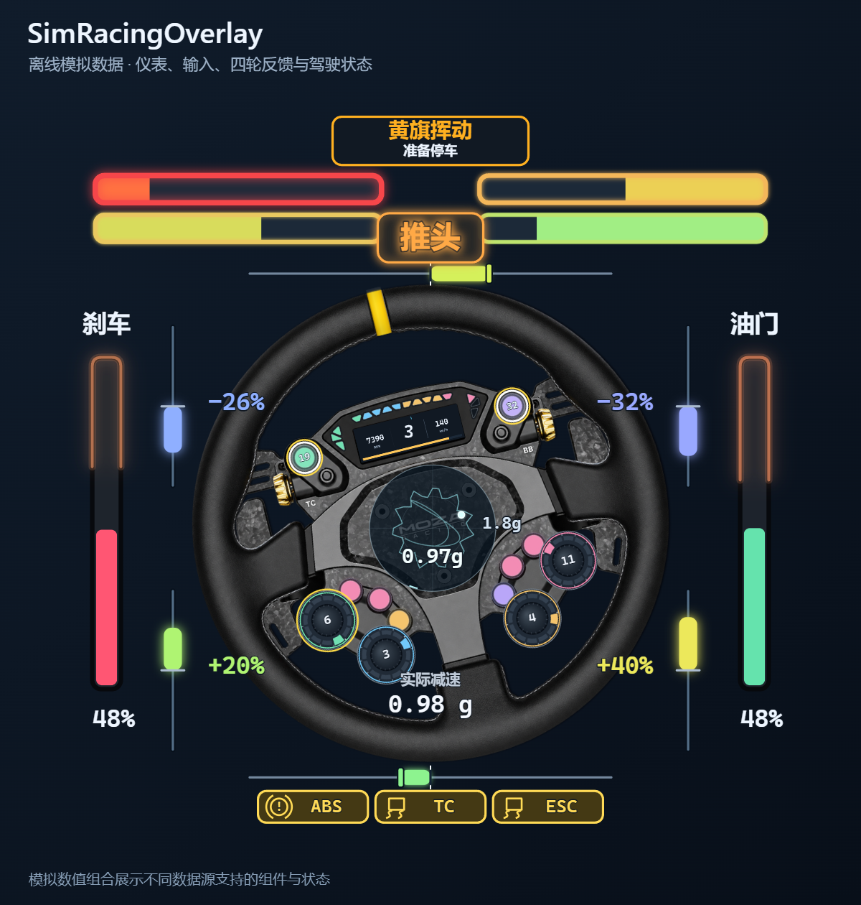
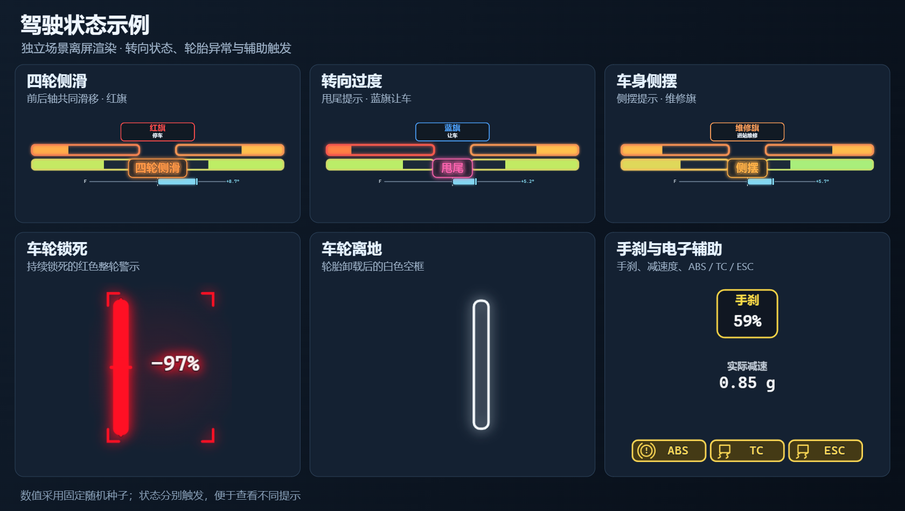

# SimRacingOverlay

赛车遥测透明叠加层：可显示在桌面上，也可作为 OBS 浏览器源使用。包括输入可视化、逐轮滑移与余量趋势、转向状态、踏板提示和 G 力球。每个控件可独立移动、缩放、旋转、显隐、锁定、调透明度和调整层级，支持多选和整体复位。默认包含轮盘图片与仪表外观，整组相对屏幕居中靠下。

## 界面预览

以下图片由实际界面**离屏渲染**生成，使用固定随机种子的模拟数值，展示随包提供的仪表样式、控件和驾驶提示。不同游戏支持的数据不同，图中组合展示各类能力；互斥状态分别呈现。

### 完整仪表与输入反馈



### 驾驶状态

总览展示推头；下图补充四轮侧滑、甩尾、侧摆、车轮锁死、离地、手刹及 ABS / TC / ESC 提示。



### 旗语与行动提示


## 下载与开始

在 [Releases](https://github.com/Cormor/SimRacingOverlay/releases) 下载 **Windows-x64.zip**，不要下载 GitHub 自动生成的 Source code 压缩包。

1. 下载 **SimRacingOverlay-1.2.0-Windows-x64.zip**，解压到普通可写目录，双击 **Start.cmd** 即可启动。运行时和资源已包含，无需安装 Python、Node.js 或开发环境。
2. 默认布局水平居中、距屏幕下边缘 2%，大小按屏幕高度自动适配。支持 720p、1080p、1440p、4K、8K 和不同 Windows 缩放；各模块的尺寸比例与相对位置保持一致。
3. 按 **Ctrl+Alt+M** 编辑布局；需要调整方向盘总转向角、独立踏板或按钮时，打开 **Setup.ps1**。设备映射保存在本机，不随共享预设分发。
4. iRacing SDK 和 ACR 原生共享内存会自动读取；F1 25 的 UDP 设置见下方接入说明。没有游戏遥测时，仍可显示设备输入并编辑布局。
5. **Install.cmd 是可选安装入口**：用于开始菜单、自启动和 SimHub / OBS 集成。需要插件集成时，安装后在下一次正常重启 SimHub 时允许 SimRacingOverlay 插件；OBS 运行期间的脚本登记会等到其关闭后完成。

使用 Install.cmd 安装时，会登记一个当前用户启动观察器：登录后在后台等待 SimHub / OBS，任一程序打开就启动 overlay。首次安装后立即生效，无需重启 Windows。桌面托盘可打开设置、隐藏画面、切换编辑。快捷键 **Ctrl+Alt+M** 进入 / 退出编辑，退出时保存。OBS 与桌面可独立显示；只要隐藏桌面，OBS 的源仍可工作。

## 布局编辑

按 **Ctrl+Alt+M** 进入编辑。单击选择，Shift / Ctrl 加选，空白处拖框多选；拖动选区、方向键微调，右下角等比缩放，角度框旋转。每个模块可独立显隐和锁定。

“移动整体”选中全部启用模块后直接拖动画布；“整体复位”恢复共享的屏幕中下方默认布局，“移回屏内”找回越界选区。支持 Ctrl+Z / Ctrl+Shift+Z 撤销与重做、对齐、布局 JSON 导入导出。修改自动保存，保存成功后退出编辑。

交互、颜色、字体、字号和图标规范见 [UE 与 UI 规范](docs/UE-UI.md)，算法版本与回放对照见 [算法基线](docs/ALGORITHM-BASELINE.md)。

## 支持范围

| 数据 / 设备 | 行为与限制 |
| --- | --- |
| ACR（Assetto Corsa Rally） | 从共享内存读取逐轮物理数据，支持本项目的轮胎与转向趋势显示。 |
| F1 25 | 可接收 2025 格式的原生 UDP，读取逐轮滑移率、侧滑角、轮胎力和载荷。需要按下文配置 SimHub UDP 转发；辅助开启设置不等于 ABS / TC 正在触发。 |
| iRacing | 直接只读接入本机 SDK 共享内存，读取基础仪表、踏板、车身运动和有效的 ABS 触发字段。缺少逐轮物理量时，用有效车身运动与转向输入估计裕度；原前后轴侧滑条可显示估计侧偏角。旗语及中文解释仅接受有效 SDK 数据。 |
| SimHub 支持的其他游戏 | 本插件导出标准化数据。速度、挡位、转速、踏板和 G 力等以游戏实际提供为准；不提供的逐轮物理量不会被伪造，部分辅助不显示。 |
| DirectInput 方向盘、踏板、手刹 | 自动枚举，支持不同品牌和多个独立设备；学习轴行程 / 反向。仅测试了本地设备与模拟映射，不能保证所有驱动和设备。 |
| 按钮 | 通用虚拟布局，支持重新学习编号；无法自动知道任意方向盘的实体位置和外形。 |
| MOZA 灯色 | 可选只读观察器读取 Pit House / SimHub 已发送的已识别灯光协议；不是硬件灯光执行回执，也不修改方向盘灯光设置。其他型号回退到软件灯效。 |
| 方向盘仪表屏 | 随包包含共享轮盘图片与仪表样式；统一字号与语义色，使用系统字体回退。 |

横向状态按四轮分别显示：左右各两根长条，上条对应前轮、下条对应后轮，同侧向画面中间填充。填充与整条颜色反映当前侧滑程度，边框加入最近 100 ms 的趋势和有支持的轮胎力响应；轮胎卸载时整条清空并显示白色辉光。纵向风险收在油门 / 刹车边框，不再单独绘制纵向条。两组横向条默认放大 2 倍，可在编辑模式调整，已有保存的大小与位置保留。

缺少某轮滑移角时，有效车身局部速度可支持降级观察；取得逐轮角度后，对应轮位优先使用独立观测。缺少足够运动数据、暂停或断流时，对应读数停止显示。

绘制跟随浏览器刷新节奏，按组件检测变化并局部重绘；未变化区域保留，重叠组件按原层级处理。静态轮盘、灯带路径和未变化的仪表内容可复用。遥测优先使用持久事件流推送，多个查看端共享采集；断线时自动使用 HTTP 并恢复事件流。遥测处理与绘制分开，重复帧跳过重复整理。轻量计算直接执行，持续较重的算法计算自动迁移至独立 Worker。适配和性能验证范围见 [iRacing 与性能验证记录](docs/IRACING-PERFORMANCE.md)。

余量和推头 / 甩尾提示是基于遥测的状态趋势，不是实测摩擦系数或保证安全的抓地极限。不同游戏暴露的数据不同，不能把 ACR 的完整能力理解为所有游戏都支持。

## F1 25 的 UDP 接入

游戏继续将遥测发送到 SimHub 原有的端口。在 SimHub 的 F1 25 游戏设置中，增加 UDP 转发目的地 **127.0.0.1:20778**；游戏的输出格式选择 **2025**，发送频率建议 **60 Hz**。不要把游戏的发送端口直接改成 20778，否则 SimHub 可能收不到数据；已有其他转发目的地也应保留。

有效 UDP 优先使用，其次是有效共享内存，两者都不可用时才使用 SimHub 备用数据。UDP 中暂缺某类包时，仅对应字段缺失，不拿较慢的 HTTP 数据补入动态状态。配置说明和字段约定见 [遥测接入说明](TELEMETRY.md)。

## 便携安装、自定义路径

安装器会检查运行中的程序、卸载注册表、开始菜单和常用安装目录。找不到便携版时，在 PowerShell 中运行：

```powershell
.\Install.ps1 -SimHubPath 'D:\Apps\SimHub' -ObsPath 'D:\Apps\obs-studio' -InstallPath 'D:\Apps\SimRacingOverlay'
```

OBS 便携配置不在常见位置时，可再加 `-ObsConfig 'D:\CustomOBSConfig'`。首次安装前最好正常关闭 OBS；安装器不改全局画布和其他来源。

## 更新与卸载

更新前关闭本软件和启动观察器，以及 SimHub（若需要更新插件）。重新运行新包的安装器，已有设置、校准和控件位置会保留。安装器发现目标应用正在运行时会停止升级，不覆盖运行文件。

开始菜单中的“卸载”只移除本软件的关联项和插件，保留配置与安装文件。请先关闭 OBS 和 SimHub；如 SimHub 在受保护目录，可能需要右键以管理员身份运行 `Uninstall.ps1`。确认不再需要后可自行删除安装目录。安装过程对 OBS 场景集合保留本地备份，位于 `runtime/integration-backup`。

手动停止：运行 `Stop-Overlay.ps1`，此操作暂停自动拉起。再次点击开始菜单的 SimRacingOverlay 恢复。它不会关闭 SimHub / OBS / Pit House。

## 隐私

不含作者的设备配置、用户路径、录像、日志、OBS 场景或原始 Git 历史。运行数据仅写本机安装目录的 `runtime`，设置仅写 `settings.json` 和 `assets/layout.json`；输入服务仅绑定 `127.0.0.1`，不提供局域网服务。不向项目作者上传遥测。分享问题时不要直接打包整个安装目录；其中可能包含你自己的设备名称、设备标识、路径和遥测。

## 源码构建

见 [构建说明](docs/BUILD.md)。安装包包含对应源码；第三方组件按各自许可证分发，见 [THIRD_PARTY_NOTICES.md](THIRD_PARTY_NOTICES.md)。

## 许可

使用与 AudioSubtitleOverlay 相同的 **Non-Commercial Source-Available License 1.0**，个人非商业使用允许，商业使用须获得授权。这是公开源码的非商业许可证，**不是 OSI 开源许可证**。详见 [LICENSE](LICENSE) 和 [COMMERCIAL-LICENSE.md](COMMERCIAL-LICENSE.md)。


## 共享预设与隐私

默认仪表外观、颜色、控件尺寸和相对位置是公开预设，记录在 `layout-preset.js`。共享预设不包含显示器 ID、个人设备实例 ID、账号、密码或访问令牌。实际设备映射、运行状态和登录凭据不会打入安装包。
