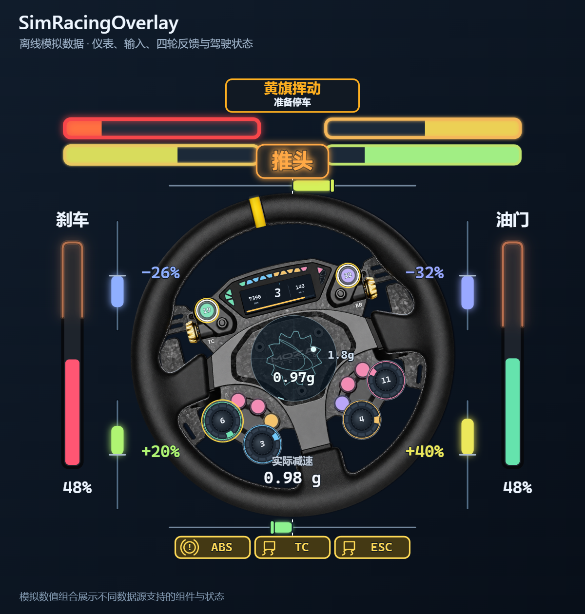

# SimRacingOverlay

适用于 Windows 的赛车遥测叠加层。实时显示方向盘、踏板、车速、挡位和转速，也可按游戏提供的数据显示四轮滑移、转向趋势、辅助状态和 G 力。HUD 可以显示在桌面上，也可以作为 OBS 浏览器源使用。

[下载最新 Windows Setup](https://github.com/Cormor/SimRacingOverlay/releases/latest) · [版本记录](CHANGELOG.md) · [安装说明](docs/INSTALL.md)

## 安装与使用

1. 在 GitHub Release 的附件中下载 `SimRacingOverlay-<版本>-Setup.exe`。安装包包含所需运行环境，支持离线安装，可选安装目录。
2. 从 Windows 开始菜单启动 **SimRacingOverlay**。单击托盘图标可打开管理窗口，右键菜单可显示或隐藏 HUD、编辑布局或退出叠加程序。关闭管理窗口后，HUD 和采集服务继续运行。
3. 在「设备输入」里确认方向盘和踏板读数。需要绑定时，学习对应的轴，采用后保存设备设置。方向盘、踏板和手刹可以来自不同的 DirectInput 设备。
4. 按默认快捷键 **Ctrl+Alt+M** 进入或完成布局编辑。拖动、缩放或旋转组件，可按需调整显示器、显隐和透明度。「显示与连接」可修改或取消布局编辑、HUD 显隐和重置 G 峰值的快捷键，也可复制 OBS 浏览器源地址。

安装版和便携版共用 `%USERPROFILE%\.lixing\SimRacingOverlay`。首次使用共享目录时，旧设置、校准、布局、盘面和组件会迁入，已有共享配置优先。使用中的桌面 HUD 和 OBS 输出可独立显示。 [Windows 安装说明](docs/INSTALL.md)

## HUD 与盘面

- **驾驶数据**包括基础仪表、四轮滑移、前后轴响应、转向状态、减速度和 G 力。可显示的项目取决于游戏实际提供的数据。转向、踏板和仪表等常规读数短时缺样时保持最后一个有效值，最长 1 秒，新读数到达后立即更新。
- **布局编辑**支持多选、对齐、整体移动、复位以及布局 JSON 导入和导出。各组件可以独立移动、缩放、旋转、锁定、显隐和调整层级。
- **方向盘**可切换已安装盘面，下载可用的盘面，或按盘面单独设置按键映射。无屏盘面可搭配独立仪表。 [方向盘盘面](docs/WHEEL-FACES.md)
- **组件样式**可用同一输入并排对照当前效果和草稿，再应用当前组件。可选项因组件而异，包括显示样式、配色、显示辅助及适用的算法和动画。 [组件样式与扩展](docs/COMPONENT-EXPERIENCE.md)

下图由实际 HUD 离屏渲染，使用模拟数据展示布局与驾驶反馈。

[驾驶状态示例](docs/images/states.png) · [iRacing 旗语示例](docs/images/flags.png)

## 管理窗口与退出

管理窗口按调整对象分组：

- **概览**：查看当前布局、游戏数据与设备状态，开启或隐藏HUD。
- **布局编辑**：拖动和调整18个组件，修改自动保存；撤销、重做和完成编辑常驻。
- **组件样式**：同输入对比已应用效果与修改预览，调整显示效果、配色和辅助。只有点击“应用到…”才提交当前组件；其它组件草稿可从目录继续调整。
- **方向盘**：选择已安装盘面会立即切换；未安装盘面先下载再使用，仪表与按键映射在同页调整。
- **设备输入**：查看真实输入并学习轴绑定。已保存绑定和待保存修改分开显示；采用后还需保存设备设置，取消采样保留原绑定。
- **显示与连接**：选择显示器、查看接入方式及复制OBS地址。版本检查和本地扩展包位于“版本与更新”。

单击托盘图标打开管理窗口，右键打开操作菜单。管理窗使用普通窗口层级，编辑时也不强制置顶。Ctrl+Alt+M 进入或完成布局编辑，组合键可在连接设置中修改。正常现场编辑可以直接拖动屏幕上的 HUD；管理面板按布局避让，拖动时暂时隐藏，空间不足时使用全屏编辑。Esc 返回管理器。布局编辑期间最小化时完成并保存编辑，保留桌面叠加显示；恢复窗口回到概览。其他页面最小化保留原页面与叠加层显隐设置。保存未完成时保留编辑并提示原因。

选择托盘的 **退出叠加程序** 会先处理当前编辑的保存，再关闭桌面及本安装的采集服务，并暂停由 SimHub / OBS 触发的自动拉起。保存被拒绝或失败时保留编辑。从开始菜单手动启动会解除暂停；仅关闭管理窗口会保留后台叠加程序。

## 布局编辑

按 **Ctrl+Alt+M** 进入编辑。单击选择，Shift / Ctrl 加选，空白处拖框多选；拖动选区、方向键微调，右下角等比缩放，角度框旋转。每个模块可独立显隐和锁定。

“整体移动”选中全部未锁定组件后直接拖动画布；“整套布局 → 恢复默认布局”恢复屏幕中下方默认布局，“移回屏内”找回越界选区。支持 Ctrl+Z / Ctrl+Shift+Z 撤销与重做、对齐、布局 JSON 导入导出。修改自动保存，保存成功后退出编辑。

编辑器还可选择方向盘盘面：默认内置原款，SIMAGIC GT Pro 圆盘可从 GitHub 下载后离线使用。按键映射按盘面保存，无屏盘面可搭配独立仪表。操作与扩展方法见 [方向盘盘面](docs/WHEEL-FACES.md)。

管理窗口和直接编辑的设计见 [UI 设计](docs/UI-DESIGN.md)，组件见 [UI 组件](docs/UI-COMPONENTS.md)，设计源见 [设计源说明](design/README.md)；原编辑规范见 [UE 与 UI 规范](docs/UE-UI.md)，算法版本与回放对照见 [算法基线](docs/ALGORITHM-BASELINE.md)。

## 组件算法与表现

管理窗的“组件样式”页列出全部18个现有HUD组件，分别展示功能算法、显示样式、动画、配色和显示辅助；固定能力也保留名称与说明。油门与刹车的轮胎响应提示可切换算法和表现，原始踏板填充继续直接显示设备输入。其他组件沿用各自的现有算法，配色作用于真实组件内容。内置动画采用即时更新；扩展包可提供表达状态或变化的动画。

当前已应用与正在调整的草稿并排动态显示，使用相同输入和时间。所选组件立即显示有效的内置演示，并在短周期内持续变化；可播放、暂停和从头演示，暂停后切换组件或选项仍立即显示内容。没有遥测时使用明确标识的内置演示输入，演示不会写入遥测或运行配置。每个组件可选择标准、Protan、Deutan、Tritan或高对比配色；配色只改变颜色，保留当前分段、虚线、边框和文字。显示辅助单独选择标准、色弱辅助或高对比，沿原组件的位置补充读数与标记，保留原有形状和显示条件。旧配置和草稿保留原有四项选择，新增显示辅助默认标准。

应用前检查能力组合，成功后保存当前组件选择并刷新 HUD；其他组件的草稿保留。随包的 `examples/pedal-motion.component.json` 可直接导入，`examples/component-package/` 提供可编辑源码。代码扩展需要可信来源，盘面仍使用不执行代码的数据包。契约与扩展方法见 [组件插件](docs/COMPONENT-PLUGINS.md)，交互方法见 [组件体验](docs/COMPONENT-EXPERIENCE.md)，配色依据与范围见 [组件无障碍配色](docs/COMPONENT-ACCESSIBILITY.md)。

## 支持范围

| 数据 / 设备 | 行为与限制 |
| --- | --- |
| ACR（Assetto Corsa Rally） | 从共享内存读取逐轮物理数据，支持本项目的轮胎与转向趋势显示。 |
| F1 25 | 可接收 2025 格式的原生 UDP，读取逐轮滑移率、侧滑角、轮胎力和载荷。需要按下文配置 SimHub UDP 转发；辅助开启设置不等于 ABS / TC 正在触发。 |
| iRacing | 直接只读接入本机 SDK 共享内存，读取基础仪表、踏板、车身运动和有效的 ABS 触发字段。缺少逐轮物理量时，用有效车身运动与转向输入估计裕度；原前后轴侧滑条可显示估计侧偏角。旗语及中文解释仅接受有效 SDK 数据。 |
| SimHub 支持的其他游戏 | 本插件导出标准化数据。速度、挡位、转速、踏板和 G 力等以游戏实际提供为准；不提供的逐轮物理量不会被伪造，部分辅助不显示。 |
| DirectInput 方向盘、踏板、手刹 | 自动枚举，支持不同品牌和多个独立设备；学习轴行程 / 反向。仅测试了本地设备与模拟映射，不能保证所有驱动和设备。 |
| 按钮 | 盘面分别定义实体位置；可录入或手动设置各位置的按钮编号，按盘面保存。 |
| MOZA 灯色 | 可选只读观察器读取 Pit House / SimHub 已发送的已识别灯光协议；不是硬件灯光执行回执，也不修改方向盘灯光设置。其他型号回退到软件灯效。 |
| 方向盘仪表屏 | 按盘面屏幕能力显示；无屏盘面可选择独立仪表。统一字号与语义色，使用系统字体回退。 |

横向状态按四轮分别显示：左右各两根长条，上条对应前轮、下条对应后轮，同侧向画面中间填充。填充与整条颜色反映当前侧滑程度，边框加入最近 100 ms 的趋势和有支持的轮胎力响应；轮胎卸载时整条清空并显示白色辉光。纵向风险收在油门 / 刹车边框，不再单独绘制纵向条。两组横向条默认放大 2 倍，可在编辑模式调整，已有保存的大小与位置保留。

缺少某轮滑移角时，有效车身局部速度可支持降级观察；取得逐轮角度后，对应轮位优先使用独立观测。短时缺样时常规读数保持最后有效显示值最多 1 秒，暂停及切换会话按各自状态处理。

绘制跟随浏览器刷新节奏，按组件检测变化并局部重绘；未变化区域保留，重叠组件按原层级处理。静态轮盘、灯带路径和未变化的仪表内容可复用。遥测优先使用持久事件流推送，多个查看端共享采集；断线时自动使用 HTTP 并恢复事件流。遥测处理与绘制分开，重复帧跳过重复整理。计算会话从首个样本固定处理拥有者；Worker 机制故障后在下一新样本建立主线程模型，不重放失败帧或恢复旧模型。适配和性能验证范围见 [iRacing 与性能验证记录](docs/IRACING-PERFORMANCE.md)。

余量和推头 / 甩尾提示是基于遥测的状态趋势，不是实测摩擦系数或保证安全的抓地极限。不同游戏暴露的数据不同，不能把 ACR 的完整能力理解为所有游戏都支持。

## F1 25 的 UDP 接入

游戏继续将遥测发送到 SimHub 原有的端口。在 SimHub 的 F1 25 游戏设置中，增加 UDP 转发目的地 **127.0.0.1:20778**；游戏的输出格式选择 **2025**，发送频率建议 **60 Hz**。不要把游戏的发送端口直接改成 20778，否则 SimHub 可能收不到数据；已有其他转发目的地也应保留。

有效 UDP 优先使用，其次是有效共享内存，两者都不可用时才使用 SimHub 备用数据。UDP 中暂缺某类包时，仅对应字段缺失，不拿较慢的 HTTP 数据补入动态状态。配置说明和字段约定见 [遥测接入说明](TELEMETRY.md)。

## 更新、卸载和数据

在管理窗口的「版本与更新」检查 GitHub 正式版本。应用先验证发行清单的签名，再核对下载文件的摘要。更新由用户确认，完整升级沿用原安装目录和共享配置。 [更新与本地扩展](docs/UPDATES.md)

在 Windows「已安装的应用」中卸载 SimRacingOverlay，用户设置和布局留在共享配置目录。采集服务仅监听本机，遥测保留在本机。分享故障材料时，请先检查其中的设备名称、路径和遥测。

## 支持开发与源码

管理窗口侧栏的「支持开发」提供自愿支持入口。 [支持开发](docs/SUPPORT-DEVELOPMENT.md)

[构建说明](docs/BUILD.md) · [第三方声明](THIRD_PARTY_NOTICES.md)

自研部分采用 **Non-Commercial Source-Available License 1.0**，允许个人非商业使用，商业使用须获得授权。 [许可证](LICENSE) · [商业授权](COMMERCIAL-LICENSE.md)
